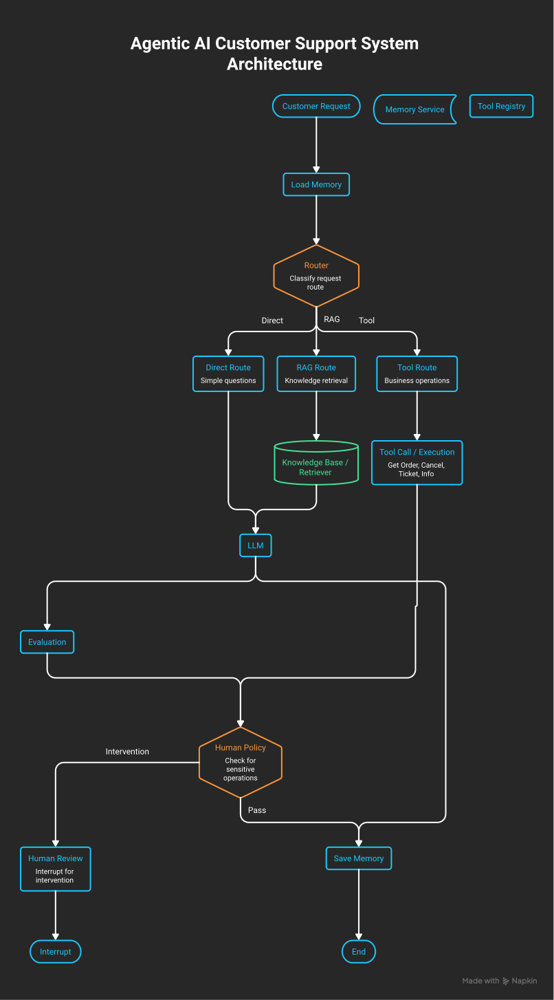

# Agentic AI Customer Support

An AI-powered customer-support agent built with **LangGraph**, **LangChain**, and **FastAPI**. The system routes customer requests, retrieves information from a knowledge base, uses business tools, maintains conversation memory, evaluates RAG responses, and pauses sensitive operations for human review.

> The project is an evolving engineering implementation. The documentation describes the current `develop` branch; planned improvements are listed separately.

## Key Features

- **Agentic workflow:** LangGraph orchestrates direct, RAG, and tool-based request paths.
- **Knowledge retrieval:** A document pipeline builds embeddings and a FAISS vector index.
- **Business tools:** The agent can look up orders, cancel orders, create tickets, retrieve customer information, and search the knowledge base.
- **Conversation memory:** Memory and graph checkpointing support conversation context and paused workflows.
- **Evaluation:** Retrieval relevance, answer faithfulness, and confidence signals are used in the RAG path.
- **Human-in-the-loop:** Sensitive operations and low-confidence responses can pause for operator review.
- **Guardrails:** Input and output validation help prevent invalid or unsafe content from passing through the workflow.
- **Error recovery:** Error classification and retry policies handle recoverable failures.
- **API:** FastAPI exposes agent and human-review endpoints.
- **Containerization:** Docker Compose runs the API and PostgreSQL services.

## Architecture



The main request flow is:

```text
Client
  |
FastAPI
  |
AgentService
  |
Load Memory -> Router
                 |
       +---------+---------+
       |         |         |
     Direct     RAG       Tool
       |         |         |
       LLM    Retriever  Tool Selection
                 |         |
                LLM    Human Policy
                 |         |
             Evaluation  Review if needed
                 |         |
             Human Policy  Tool Execution
                 |         |
          Human Review?    LLM
                 |         |
             Save Memory <-+
                 |
                END
```

The router selects one of three routes:

| Route | Use |
|---|---|
| `direct` | General requests that do not require retrieval or business tools. |
| `rag` | Questions that need information from the knowledge base. |
| `tool` | Requests that require a business operation or lookup. |

For sensitive operations, the graph can pause through LangGraph `interrupt()`. The API exposes the pending review to an operator and resumes the same graph thread after a decision is submitted.

## Technology Stack

| Area | Technologies |
|---|---|
| Language | Python 3.13 |
| Agent orchestration | LangGraph, LangChain |
| API | FastAPI, Pydantic |
| Database | PostgreSQL, SQLAlchemy |
| Retrieval | Sentence Transformers, FAISS |
| LLM providers | OpenAI-compatible APIs (configured for Groq / other providers) |
| Evaluation | Custom retrieval, faithfulness, and confidence evaluators |
| Observability | LangSmith |
| Containerization | Docker, Docker Compose |
| Testing | unittest |

## Project Structure

```text
Agentic-AI-Customer-Support/
├── agent/
│   ├── errors/          # Error classification and retry policies
│   ├── guardrails/      # Input and output validation
│   ├── human_loop/      # Human-review models, policies, and handler
│   ├── memory/          # Conversation memory and persistence
│   ├── router/          # Request routing
│   ├── tools/           # Business tools, registry, and executor
│   ├── agent_service.py
│   ├── graph.py
│   ├── nodes.py
│   └── state.py
├── app/
│   ├── routes/          # FastAPI endpoints
│   ├── admincli.py      # Terminal operator client
│   ├── database.py
│   ├── main.py
│   ├── models.py
│   └── schemas.py
├── knowledge_base/      # Loading, processing, chunking, embeddings, FAISS, retrieval
├── evaluation/
│   ├── dataset/
│   ├── evaluators/
│   ├── reporting/
│   └── runner/
├── tests/
├── data/
├── docs/
├── Dockerfile
├── compose.yaml
├── requirements.txt
└── .env.example
```

## Getting Started

### Prerequisites

- Python 3.13
- Git
- Docker Desktop with Docker Compose (for containerized setup)
- API key for the configured LLM provider

### 1. Clone the repository

```bash
git clone https://github.com/parsahdy/Agentic-AI-Customer-Support.git
cd Agentic-AI-Customer-Support
git switch develop
```

### 2. Configure environment variables

Create your local environment file:

**PowerShell**
```powershell
Copy-Item .env.example .env
```

Set real credentials in `.env`. At minimum, configure the PostgreSQL values used by `compose.yaml` (`POSTGRES_USER`, `POSTGRES_PASSWORD`, and `POSTGRES_DB`) and the LLM provider key (`GROQ_API_KEY`). Keep `.env` out of version control; never commit API keys or passwords.

### 3. Run with Docker Compose

```bash
docker compose up --build
```

Compose starts PostgreSQL and waits for its health check before starting the API. The API is available at:

- API: http://localhost:8000
- Swagger UI: http://localhost:8000/docs

Stop the services with:

```bash
docker compose down
```

To remove the persisted PostgreSQL volume as well (this deletes local database data):

```bash
docker compose down -v
```

### 4. Run locally without Docker

Create and activate a virtual environment, install dependencies, and configure a locally reachable PostgreSQL instance.

**PowerShell**
```powershell
python -m venv venv
.\venv\Scripts\Activate.ps1
pip install -r requirements.txt
```

Set database hosts to `localhost` in your local `.env` connection strings, then start the API:

```powershell
uvicorn app.main:app --reload
```

The database must be running and the configured database must already exist.

## API Endpoints

| Method | Endpoint | Description |
|---|---|---|
| POST | `/agent/ask` | Submit a query to the agent. |
| GET | `/agent/reviews/pending` | Retrieve requests waiting for human review. |
| POST | `/agent/reviews/{review_id}/decision` | Submit `approve`, `reject`, or `escalate` and resume the workflow. |

Example request:

```json
{
  "query": "What is the status of order 1234?",
  "user_id": "customer-001",
  "session_id": "session-001"
}
```

The terminal operator client can be run separately while the API is running:

```bash
python -m app.admincli
```

It polls the pending-review endpoint and sends the operator's decision to the API.

## Evaluation

The scenario dataset is located at `evaluation/dataset/agent_evaluation.json`. Run the evaluation workflow with:

```bash
python -m evaluation.runner.agent_evaluation_runner
```

The runner stores observed outcomes in `evaluation/dataset/agent_outcome.json`.

With Docker Compose, run the optional evaluation service using:

```bash
docker compose --profile eval run --rm evaluation
```

## Tests

Run the agent workflow tests from the project root:

```bash
python -m tests.agent_tests.agent_workflow_test
```

Other tests are organized under `tests/` by component.

## Documentation

- [System Architecture](docs/architecture.md)
- [Agent Workflow](docs/agent_architecture.md)
- [API Structure](docs/api_structure.md)
- [Knowledge Base](docs/knowledge_base_structure.md)
- [Evaluation Strategy](docs/evaluation_strategy.md)
- [Project Roadmap](docs/project_steps.md)
- [Git Strategy](docs/git_strategy.md)

## Current Status

The repository includes the core agent workflow, RAG integration, business tool execution, memory/checkpointing, human-review pause/resume, guardrails, FastAPI endpoints, Docker Compose configuration, and a scenario evaluation runner.

Further work includes richer evaluation reporting, a web-based operator interface, expanded automated tests, and production hardening.

## License

See [LICENSE](LICENSE).
